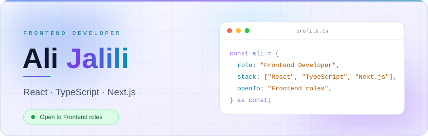
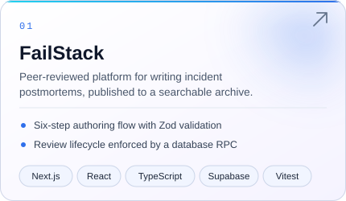
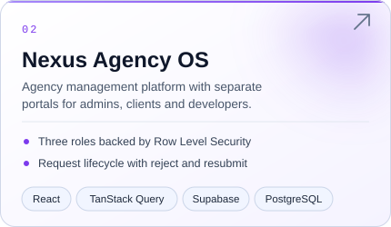
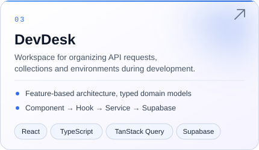
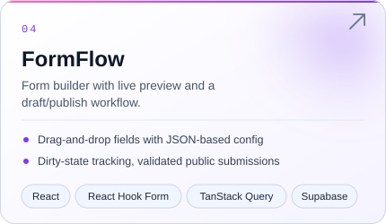
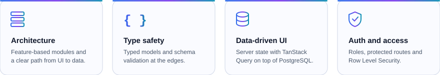
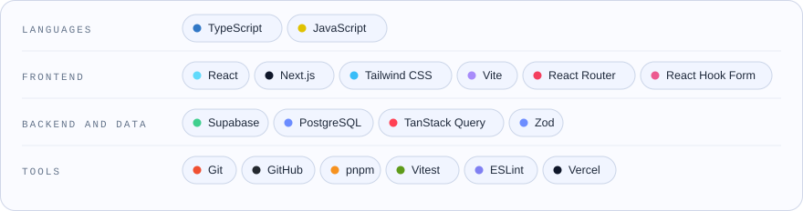
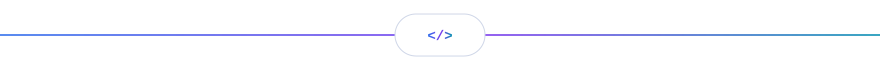

 

I build web applications around real workflows: 
authentication, role-based access, multi-step forms and review pipelines.

 

 

## Selected projects

<table>
  <tr>
    <td width="50%" valign="top">
      
      
<a href="https://failstack.vercel.app"><b>Live demo →</b></a>

    </td>
    <td width="50%" valign="top">
      
      
<a href="https://nexus-os-dashboard-seven.vercel.app"><b>Live demo →</b></a>

    </td>
  </tr>
  <tr>
    <td width="50%" valign="top">
      
      
<a href="https://devdesk-six.vercel.app"><b>Live demo →</b></a>

    </td>
    <td width="50%" valign="top">
      
      
<a href="https://form-flow-phi.vercel.app"><b>Live demo →</b></a>

    </td>
  </tr>
</table>

Click a card for the source code. Every project has a demo login in its README.

 

## Engineering focus

 

## Stack

 

## Currently improving

- End-to-end tests and CI for my projects
- Versioned database migrations, so each project runs from a clean clone

 

