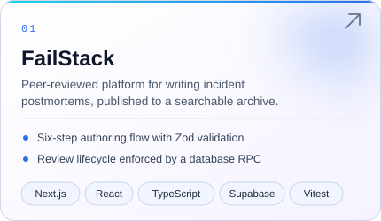
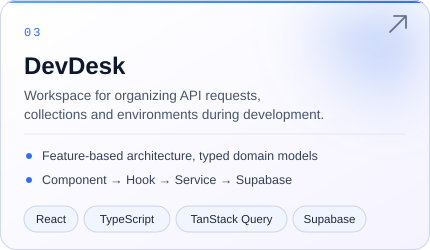
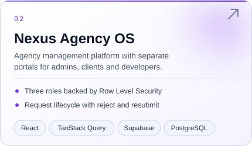
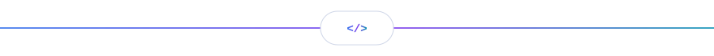

 

 

I'm a Frontend Developer focused on understanding how software works beyond the interface.

I enjoy building web applications and thinking through the engineering decisions behind them — from understanding requirements and structuring components to managing data flow and designing reliable, maintainable solutions.

Through hands-on projects, I've worked with React, Next.js, TypeScript, and modern frontend technologies, exploring application architecture, authentication, state management, and data-driven features.

 

## Selected Projects

<table>
  <tr>
    <td width="50%" valign="top">
      
      
<a href="https://failstack.vercel.app"><b>Live demo →</b></a>

    </td>
    <td width="50%" valign="top">
      
      
<a href="https://devdesk-omega.vercel.app"><b>Live demo →</b></a>

    </td>
  </tr>
  <tr>
    <td width="50%" valign="top">
      
      
<a href="https://form-flow-phi.vercel.app"><b>Live demo →</b></a>

    </td>
    <td width="50%" valign="top">
      
      
<a href="https://nexus-os-dashboard-seven.vercel.app"><b>Live demo →</b></a>

    </td>
  </tr>
</table>

Explore the source code through each project card. Demo access details are available in the individual project READMEs.

 

## Engineering Focus

 

## Technologies & Tools

 

## Let's Connect

I'm open to frontend development opportunities where I can contribute to real products, collaborate with engineering teams, and grow through meaningful engineering challenges.

  <a href="mailto:ali.jalili.dev@gmail.com">Email</a>
  ·
  <a href="https://www.linkedin.com/in/ali--jalili">LinkedIn</a>
  ·
  <a href="https://github.com/Ali-jalili">GitHub</a>
  ·
  <a href="https://ali-jalili.vercel.app/">Portfolio</a>

 

