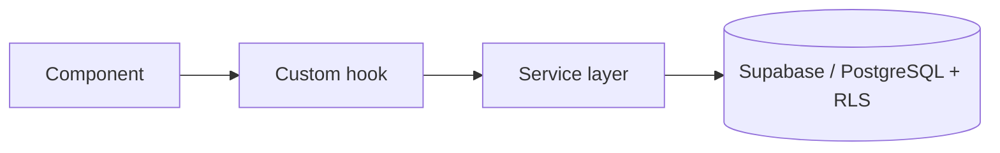

# Ali Jalili

**Frontend engineer · React, TypeScript, Next.js**

I build full-stack products where the frontend is the hard part:
multi-step forms, role-based dashboards, review workflows and server-state that stays correct.

 

---

## Selected work

| Project | What it is | Built with | Links |
|---|---|---|---|
| **FailStack** | Peer-reviewed incident postmortem platform. Six-step authoring flow, review workflow (`DRAFT → PENDING_REVIEW → PUBLISHED`), searchable public archive. | Next.js 16 (App Router), React 19, TypeScript, Supabase, Zod, Vitest | [Live](https://failstack.vercel.app) · [Code](https://github.com/Ali-jalili/failstack) |
| **NexusOS** | Multi-role agency dashboard (Admin / Client / Developer) with request lifecycle, project tracking and analytics. Access control enforced in the database with Row Level Security. | React, TanStack Query, Supabase, PostgreSQL | [Live](https://nexus-os-dashboard-seven.vercel.app) · [Code](https://github.com/Ali-jalili/NexusOS-Platform) |
| **FormFlow** | Form builder with drag-and-drop fields, live preview, draft/publish workflow and a responses dashboard. | React, React Hook Form, TanStack Query, Supabase | [Live](https://form-flow-phi.vercel.app) · [Code](https://github.com/Ali-jalili/FormFlow) |
| **DevDesk** | Workspace for organizing API requests, collections and environments. 240+ commits, feature-based architecture. | React, TypeScript, TanStack Query, Supabase | [Live](https://devdesk-six.vercel.app) · [Code](https://github.com/Ali-jalili/DevDesk) |

---

## How I build

- **Feature-based structure.** Code is grouped by product domain, not by file type.
- **Validate at both boundaries.** Zod schemas on the client and again on the server.
- **Server state belongs to a cache.** TanStack Query for fetching, invalidation and optimistic updates.
- **Security lives in the database.** Row Level Security and RPCs, not only UI guards.
- **Handle retries.** Idempotency keys so a double submit does not create two records.

---

## Stack

---

## Currently working on

- End-to-end tests and CI for my projects
- Database migrations in the repos, so every project runs from a clean clone
- Deeper TypeScript patterns and production-readiness
