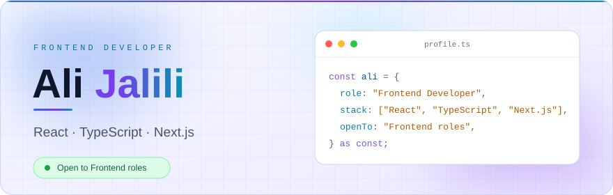
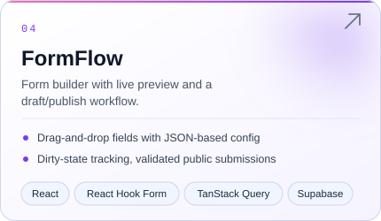
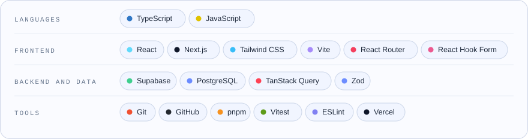

 

I learn by building, exploring how applications work, and working through the challenges that come with turning an idea into a working product.

Personal projects have been an important part of that process. They give me room to explore different approaches, make technical decisions, understand their trade-offs, and improve through practical experience.

The projects below reflect that process — each built around a different problem, workflow, and set of engineering challenges.

 

## Selected Projects

<table>
  <tr>
    <td width="50%" valign="top">
      
      
<a href="https://failstack.vercel.app"><b>Live demo →</b></a>

    </td>
    <td width="50%" valign="top">
      
      
<a href="https://devdesk-omega.vercel.app"><b>Live demo →</b></a>

    </td>
  </tr>
  <tr>
    <td width="50%" valign="top">
      
      
<a href="https://form-flow-phi.vercel.app"><b>Live demo →</b></a>

    </td>
    <td width="50%" valign="top">
      
      
<a href="https://nexus-os-dashboard-seven.vercel.app"><b>Live demo →</b></a>

    </td>
  </tr>
</table>

Explore each project's source code through its card. Demo access details are available in the individual project READMEs.

 

## Engineering Focus

 

## Technologies & Tools

 

## Connect

  <a href="https://ali-jalili.vercel.app/">Portfolio</a>
  ·
  <a href="https://www.linkedin.com/in/ali--jalili">LinkedIn</a>
  ·
  <a href="mailto:ali.jalili.dev@gmail.com">Email</a>

 

